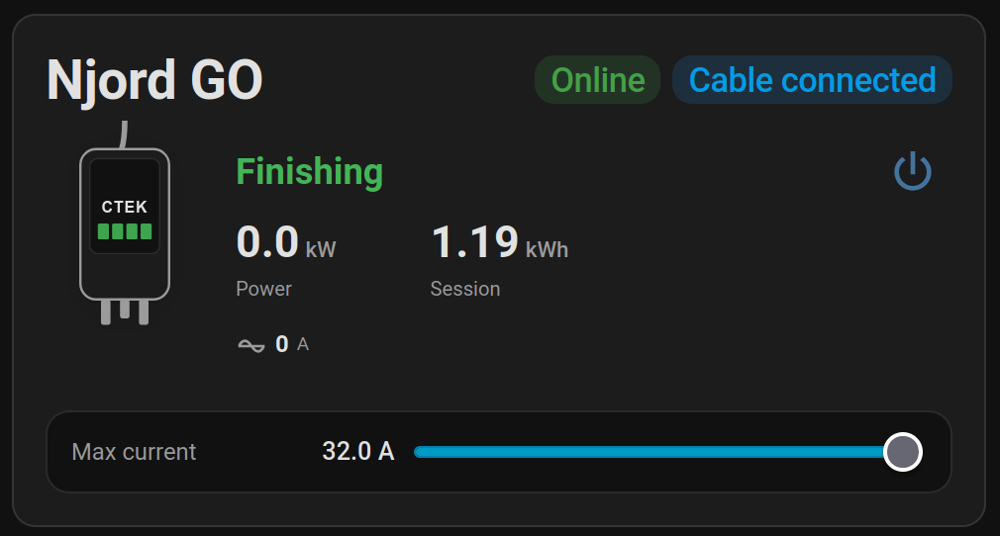
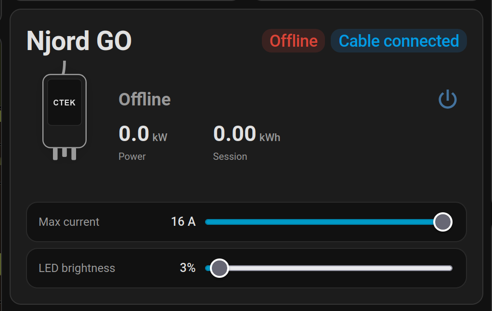

# CTEK Njord GO card

A Home Assistant Lovelace card for the CTEK Njord GO EV charger. It shows the connector status, power, session energy and cable/online state, and lets you start or stop charging and set the maximum current.

| OCPP integration | CTEK cloud integration |
|---|---|
|  |  |
| After a finished session. | Charger offline. Voltage and LED rows are shown when the integration provides them. |

## Supported integrations

The card works with devices from either integration. It picks the right one automatically from the device you select.

| Feature | CTEK cloud (`ctek`) | OCPP (`ocpp`) |
|---|---|---|
| Status, power, energy, current | yes | yes |
| Start/stop charging | yes | yes (`charge_control` switch) |
| Max current slider | yes | yes (`maximum_current`) |
| Cable and online badges | from entities | derived from the connector status |
| Charging "since" time | start date | charging duration (`time_session`) |
| Voltage | yes | not shown (the charger does not report it) |
| LED brightness slider | yes | not shown (no OCPP entity) |

Rows without an entity are hidden. With OCPP, entities are found by name (for example `*_status_connector`), so renaming them breaks the lookup.

## Installation

1. In HACS, add this repository as a custom repository of type **Dashboard**.
2. Install **CTEK Njord card** and reload the browser.
3. Add the card to a dashboard and pick your charger in the device selector.

## Configuration

| Option | Description |
|---|---|
| `device_id` | The charger device (required, chosen in the editor) |
| `title` | Card title (optional) |
| `show_voltage` | Show voltage when available (default `true`) |
| `show_current` | Show current in amperes (default `true`) |

```yaml
type: custom:ctek-njord-go-card
device_id: <device id>
title: Njord GO
```
